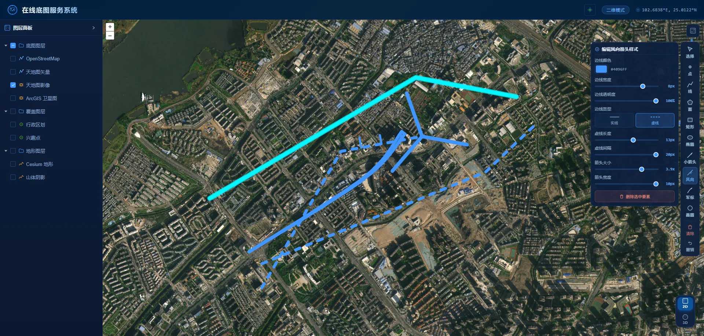
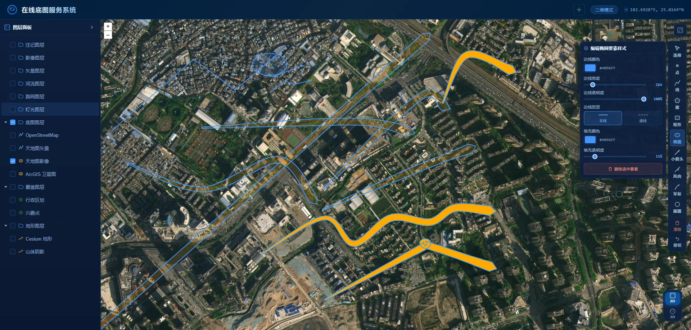
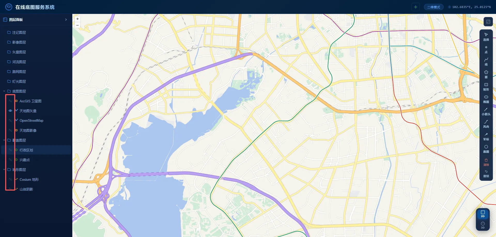
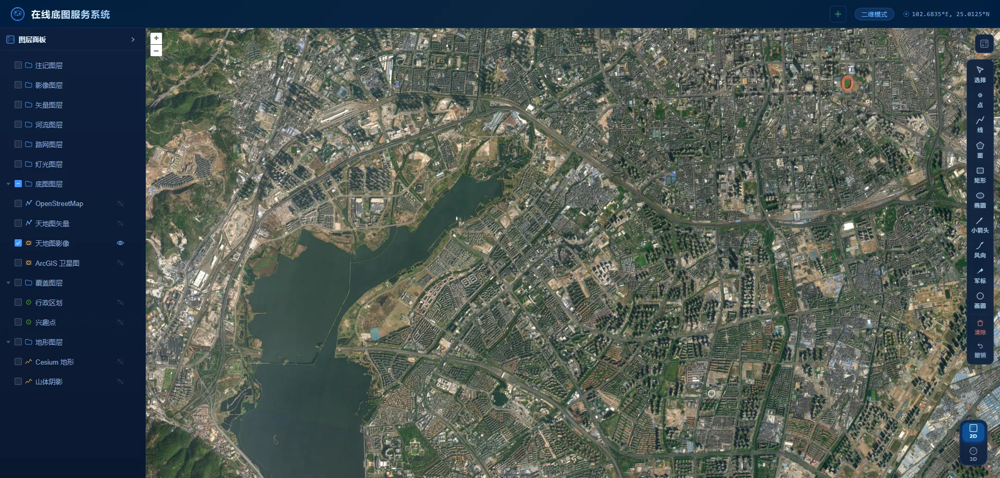
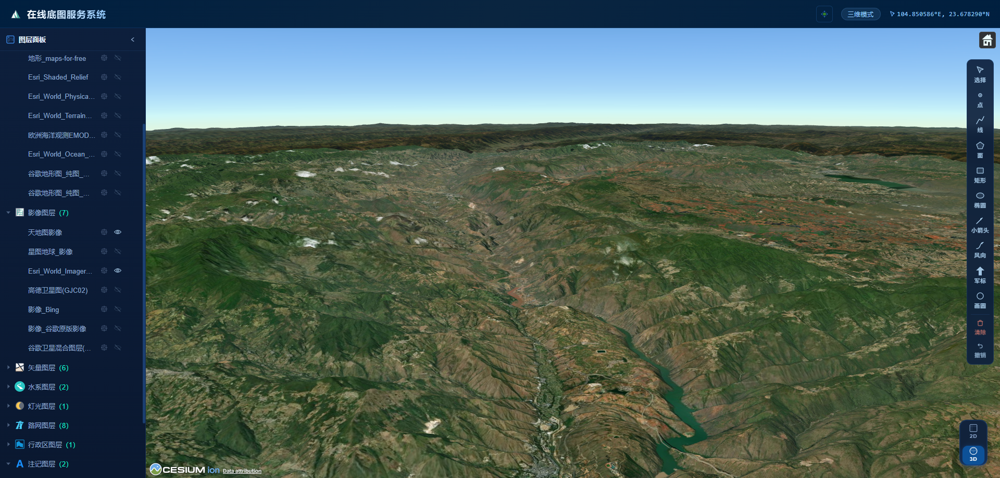

# 🗺️ 在线底图服务系统

> 这是一个Web项目，旨在打造全网最全在线底图整合系统。收集整理地球上所有的在线底图、标注、影像、矢量图层以及地形数据，构建二三维一体化应用。


## 🛠️ 技术框架
纯前端项目，使用流行的前端库进行打造。

技术包： `Vue3 + OpenLayers + Cesium` 

构建工具：`Vite`

## 🔗 项目地址

在线访问：https://gis-road.github.io/basemap/

GitHub 仓库：https://github.com/gis-road/basemap

## 📂 项目结构
```
basemap/
├── index.html                    # 入口 HTML
├── package.json                  # 依赖配置
├── package-lock.json
├── vite.config.js                # Vite 构建配置
├── README.md
├── .gitignore
│
├── public/
│   └── vite.svg
│
└── src/
    ├── main.js                   # Vue 应用入口
    ├── App.vue                   # 根组件（Header / 地图 / 图层面板 / 绘制工具栏）
    │
    ├── assets/
    │   └── styles.css            # 全局样式 + CSS 变量（科技蓝主题）
    │
    ├── components/
    │   ├── DrawingToolbar.vue    # 绘制工具栏（选择/画线/多边形/矩形/圆/箭头/样式面板）
    │   ├── LayerTree.vue         # 图层面板（树形结构/复选框/眼睛/拖拽排序）
    │   └── MapToggle.vue         # 2D/3D 切换按钮
    │
    ├── composables/
    │   ├── useMap2D.js           # OpenLayers 二维地图逻辑（初始化/底图/图层/绘制层）
    │   └── useMap3D.js           # Cesium 三维地图逻辑（初始化/相机/飞行动画）
    │
    ├── stores/
    │   └── mapStore.js           # Pinia 状态管理（地图模式/底图/中心/缩放/图层树/绘制状态）
    │
    └── config/
        └── layers.js             # 图层配置
```
## 🖼️ 项目效果

| 绘制线段 | 绘制箭头 | 矢量底图 |
|:---:|:---:|:---:|
|  |  |  |

| 影像底图 | 绘制面 | 绘制矩形 |
|:---:|:---:|:---:|
|  |  |  |

| 军事箭头 | 3D影像 | 3D影像 |
|:---:|:---:|:---:|
|  |  |  |

| 3D地形 | ESRI地形 | 天地图地形影像 |
|:---:|:---:|:---:|
|  |  |  |


## ✨ 项目特点
- 二三维一体化应用
- 在线底图服务
- 个性化绘制和编辑

## 🚀 如何运行
`node` 版本要求22+

项目运行
```
npm install
npm run dev
```

项目打包
```
npm run build
```

## 🛰️ 图层列表

> 共 51 个图层，11 列属性。


| 序号 | 所属目录 | 图层ID | 图层名称 | 服务名称 | 服务类型 | 图层类型 | 服务地址 | 分组 | 默认可见 | 缩放级别 |
|---|---|---|---|---|---|---|---|---|---|---|
| 1 | 地形图层 | Relief_esri_maps_white | 山体阴影_白色_esri | 山体阴影_白色_esri | XYZ 瓦片 | 地形 | [server.arcgisonline.com](https://server.arcgisonline.com/arcgis/rest/services/Elevation/World_Hillshade/MapServer/tile/{z}/{y}/{x}) | terrain | 否 | - |
| 2 | 地形图层 | relief_esri—black | 山体阴影_黑色_esri | 山体阴影_黑色_esri | XYZ 瓦片 | 地形 | [server.arcgisonline.com](https://server.arcgisonline.com/arcgis/rest/services/Elevation/World_Hillshade_Dark/MapServer/tile/{z}/{y}/{x}) | terrain | 否 | - |
| 3 | 地形图层 | relief_ter_tianditu | 山体阴影_天地图 | 山体阴影_天地图 | XYZ 瓦片 | 地形 | [t{0-7}.tianditu.gov.cn](https://t{0-7}.tianditu.gov.cn/DataServer?T=ter_w&x={x}&y={y}&l={z}&tk=fa7ec9766b2c00747e3dd60ab3d05892) | terrain | 否 | - |
| 4 | 地形图层 | terrain_World_maps-for-free | 地形_maps-for-free | World_maps-for-free | maps-for-free 地形 | 地形 | [maps-for-free（本地代理）](/maps-for-free/layer/relief/z{z}/row{y}/{z}_{x}-{y}.jpg) | terrain | 否 | - |
| 5 | 地形图层 | terrain_Esri_Shaded_Relief | Esri_Shaded_Relief | Esri_Shaded_Relief | XYZ 瓦片 | 地形 | [server.arcgisonline.com](https://server.arcgisonline.com/arcgis/rest/services/World_Shaded_Relief/MapServer/tile/{z}/{y}/{x}) | terrain | 否 | - |
| 6 | 地形图层 | terrain_Esri_World_Physical_Map | Esri_World_Physical_Map | Esri_World_Physical_Map | XYZ 瓦片 | 地形 | [server.arcgisonline.com](https://server.arcgisonline.com/arcgis/rest/services/World_Physical_Map/MapServer/tile/{z}/{y}/{x}) | terrain | 否 | - |
| 7 | 地形图层 | terrain_World_Terrain_Base | Esri_World_Terrain_Base | Esri_World_Terrain_Base | XYZ 瓦片 | 地形 | [server.arcgisonline.com](https://server.arcgisonline.com/arcgis/rest/services/World_Terrain_Base/MapServer/tile/{z}/{y}/{x}) | terrain | 否 | - |
| 8 | 地形图层 | terrain_EMODnet | 欧洲海洋观测EMODnet | 欧洲海洋观测EMODnet | XYZ 瓦片 | 地形 | [tiles.emodnet-bathymetry.eu](https://tiles.emodnet-bathymetry.eu/2020/baselayer/web_mercator/{z}/{x}/{y}.png) | terrain | 否 | - |
| 9 | 地形图层 | terrain_World_Ocean_Base | Esri_World_Ocean_Base | Esri_World_Ocean_Base | XYZ 瓦片 | 地形 | [server.arcgisonline.com](https://server.arcgisonline.com/arcgis/rest/services/Ocean/World_Ocean_Base/MapServer/tile/{z}/{y}/{x}) | terrain | 否 | - |
| 10 | 地形图层 | terrain_google_pure_landuse | 谷歌地形图_纯图_土地利用 | 谷歌地形图_纯图_土地利用 | XYZ 瓦片 | 地形 | [mt0.google.com](http://mt0.google.com/vt/lyrs=p&hl=en&x={x}&y={y}&z={z}&s=Ga&apistyle=s.e:l\|p.v:off,s.t:1\|s.e:g\|p.v:off,s.t:21\|p.v:off,s.t:20\|p.v:off,s.t:2\|p.v:off,s.t:3\|p.v:off,s.t:3\|s.e:l.i\|p.v:off,s.t:4\|p.v:off) | terrain | 否 | - |
| 11 | 地形图层 | terrain_google_pure_gray | 谷歌地形图_纯图_灰色 | 谷歌地形图_纯图_灰色 | XYZ 瓦片 | 地形 | [www.google.com](http://www.google.com/maps/vt/pb=!1m4!1m3!1i{z}!2i{x}!3i{y}!2m1!1e5) | terrain | 否 | - |
| 12 | 影像图层 | tianditu_img | 天地图影像 | tianditu_img | XYZ 瓦片 | 影像 | [t{0-7}.tianditu.gov.cn](https://t{0-7}.tianditu.gov.cn/DataServer?T=img_w&x={x}&y={y}&l={z}&tk=fa7ec9766b2c00747e3dd60ab3d05892) | image | 是 | - |
| 13 | 影像图层 | geovisearth | 星图地球_影像 | 星图地球 | XYZ 瓦片 | 影像 | [tiles.geovisearth.com](https://tiles.geovisearth.com/base/v1/img/{z}/{x}/{y}?format=webp&tmsIds=w&token=15d2ddab335383b5d485b78a3e04ac9f92683ee2e3b04cdf862cb292168674e7) | image | 是 | - |
| 14 | 影像图层 | esri_World_Imagery | Esri_World_Imagery_卫星图 | Esri_World_Imagery_卫星图 | XYZ 瓦片 | 影像 | [server.arcgisonline.com](https://server.arcgisonline.com/ArcGIS/rest/services/World_Imagery/MapServer/tile/{z}/{y}/{x}) | image | 否 | - |
| 15 | 影像图层 | gaode_image | 高德卫星图(GJC02)（有偏移） | 高德卫星图(GJC02)（有偏移） | XYZ 瓦片 | 影像 | [webst01.is.autonavi.com](https://webst01.is.autonavi.com/appmaptile?style=6&x={x}&y={y}&z={z}) | image | 否 | - |
| 16 | 影像图层 | baidu_image | 百度卫星影像 | 百度卫星影像 | baidu | 影像 | [maponline{s}.bdimg.com](https://maponline{s}.bdimg.com/starpic/?qt=satepc&u=x={x};y={y};z={z};v=009;type=sate&fm=46) | image | 否 | - |
| 17 | 影像图层 | google_origin_image | 影像_谷歌原版影像 | 影像_谷歌原版影像 | XYZ 瓦片 | 影像 | [mt1.google.com](https://mt1.google.com/vt/lyrs=s&x={x}&y={y}&z={z}) | image | 否 | - |
| 18 | 影像图层 | google_image_hybrid | 谷歌卫星混合图层(GCJ02)（有偏移） | 谷歌卫星混合图层(GCJ02)（有偏移） | XYZ 瓦片 | 影像 | [mt.google.com](http://mt.google.com/vt?lyrs=s,m&gl=CN&x={x}&y={y}&z={z}) | image | 否 | - |
| 19 | 矢量图层 | tdt_vector | 天地图矢量图层 | tianditu_vec | XYZ 瓦片 | 矢量 | [t{0-7}.tianditu.gov.cn](https://t{0-7}.tianditu.gov.cn/DataServer?T=vec_w&x={x}&y={y}&l={z}&tk=fa7ec9766b2c00747e3dd60ab3d05892) | vector | 否 | - |
| 20 | 矢量图层 | Esri_USA_Topo_Maps | USA_Topo_Maps | USA_Topo_Maps | XYZ 瓦片 | 矢量 | [server.arcgisonline.com](https://server.arcgisonline.com/arcgis/rest/services/USA_Topo_Maps/MapServer/tile/{z}/{y}/{x}) | vector | 否 | - |
| 21 | 矢量图层 | Esri_World_Topo_Map | World_Topo_Map | World_Topo_Map | XYZ 瓦片 | 矢量 | [server.arcgisonline.com](https://server.arcgisonline.com/arcgis/rest/services/World_Topo_Map/MapServer/tile/{z}/{y}/{x}) | vector | 否 | - |
| 22 | 矢量图层 | osm_vector | OpenStreetMap | osm | XYZ 瓦片 | 矢量 | [tile.openstreetmap.org](https://tile.openstreetmap.org/{z}/{x}/{y}.png) | vector | 否 | - |
| 23 | 矢量图层 | Open_Topo_Map_vector | Open_Topo_Map | Open_Topo_Map | XYZ 瓦片 | 矢量 | [tile.opentopomap.org](https://tile.opentopomap.org/{z}/{x}/{y}.png) | vector | 否 | - |
| 24 | 矢量图层 | Bing电子地图_vector | Bing电子地图 | Bing电子地图 | XYZ 瓦片 | 矢量 | [t.ssl.ak.dynamic.tiles.virtualearth.net](https://t.ssl.ak.dynamic.tiles.virtualearth.net/comp/ch/a{q}.ipeg?g=0&mkt=zh_CN&it=GB,LC&shading=hill&n=t&og=2697&sv=9.38&cstl=s23&o=png&ur=hk) | vector | 否 | - |
| 25 | 水系图层 | tencent_river | 腾讯路网标注图（水系） | 腾讯路网标注图（水系） | XYZ 瓦片 | 影像 | [rt0.map.gtimg.com](https://rt0.map.gtimg.com/tile?z={z}&x={x}&y={_y}&type=vector&styleid=3) | river | 否 | - |
| 26 | 水系图层 | River_World_maps-for-free | maps-for-free_World_river | River_World_maps-for-free | XYZ 瓦片 | 影像 | [maps-for-free（本地代理）](/maps-for-free/layer/water/z{z}/row{y}/{z}_{x}-{y}.gif) | river | 否 | - |
| 27 | 灯光图层 | blackmarble_3857 | 夜间灯光_BlackMarble | blackmarble_3857 | WMTS 服务 | WMTS | [tiles.maps.eox.at](https://tiles.maps.eox.at/wmts/1.0.0/WMTSCapabilities.xml) | light | 否 | - |
| 28 | 路网图层 | gaode_road_net_GJC02 | 高德路网标注图(GJC02) | 高德路网标注图(GJC02) | XYZ 瓦片 | 路网 | [wprd01.is.autonavi.com](https://wprd01.is.autonavi.com/appmaptile?x={x}&y={y}&z={z}&lang=zh_cn&size=1&scl=2&style=8<ype=11) | road_net | 否 | - |
| 29 | 路网图层 | google_road_net_GJC02 | 谷歌路网标记图层(GCJ02) | 谷歌路网标记图层(GCJ02) | XYZ 瓦片 | 路网 | [mt.google.com](http://mt.google.com/vt?lyrs=h&gl=CN&x={x}&y={y}&z={z}) | road_net | 否 | - |
| 30 | 路网图层 | OpenRailwayMap_road_net | 基于OSM铁路数据的在线PNG底图_OpenRailwayMap | OpenRailwayMap | XYZ 瓦片 | 路网 | [a.tiles.openrailwaymap.org](https://a.tiles.openrailwaymap.org/standard/{z}/{x}/{y}.png) | road_net | 否 | - |
| 31 | 路网图层 | OpenRailwayMap_Maxspeed_road_net | ORM最大速度图_OpenRailwayMap_Maxspeed | OpenRailwayMap Maxspeed | XYZ 瓦片 | 路网 | [a.tiles.openrailwaymap.org](https://a.tiles.openrailwaymap.org/maxspeed/{z}/{x}/{y}.png) | road_net | 否 | - |
| 32 | 路网图层 | road_world_maps-for-free | 路网_maps-for-free | road_world_maps-for-free | XYZ 瓦片 | 路网 | [maps-for-free（本地代理）](/maps-for-free/layer/streets/z{z}/row{y}/{z}_{x}-{y}.gif) | road_net | 否 | - |
| 33 | 路网图层 | road_esri—light | 路网_白色_esri | 路网_白色_esri | XYZ 瓦片 | 路网 | [server.arcgisonline.com](https://server.arcgisonline.com/arcgis/rest/services/Canvas/World_Light_Gray_Base/MapServer/tile/{z}/{y}/{x}) | road_net | 否 | - |
| 34 | 路网图层 | road_esri—black | 路网_黑色_esri | 路网_黑色_esri | XYZ 瓦片 | 路网 | [server.arcgisonline.com](https://server.arcgisonline.com/arcgis/rest/services/Canvas/World_Dark_Gray_Base/MapServer/tile/{z}/{y}/{x}) | road_net | 否 | - |
| 35 | 路网图层 | road_osm_street | road_osm_street | road_osm_street | XYZ 瓦片 | 路网 | [tile.openstreetmap.bzh](https://tile.openstreetmap.bzh/br/{z}/{x}/{y}.png) | road_net | 否 | - |
| 36 | 路网图层 | dark_street_bing | 必应暗色街道地图（有偏移） | dark_street_bing | bingService | 路网 | [t{0-3}.dynamic.tiles.ditu.live.com](https://t{0-3}.dynamic.tiles.ditu.live.com/comp/ch/{q}?mkt=zh-CN&ur=cn&it=G,RL&n=z&og=804&cstl=vbd) | road_net | 否 | - |
| 37 | 路网图层 | colorful_street_bing | 必应彩色街道地图（有偏移） | colorful_street_bing | bingService | 路网 | [t{0-3}.dynamic.tiles.ditu.live.com](https://t{0-3}.dynamic.tiles.ditu.live.com/comp/ch/{q}?mkt=zh-CN&ur=cn&it=G,RL&n=z&og=804&cstl=vb) | road_net | 否 | - |
| 38 | 行政区图层 | Esri_World_Ocean_Reference | Esri_World_Ocean_Reference | Esri_World_Ocean_Reference | XYZ 瓦片 | 注记 | [server.arcgisonline.com](https://server.arcgisonline.com/arcgis/rest/services/Ocean/World_Ocean_Reference/MapServer/tile/{z}/{y}/{x}) | anotation | 否 | - |
| 39 | 行政区图层 | Admin_World_maps-for-free | Admin_maps-for-free_world | Admin_World_maps-for-free | XYZ 瓦片 | 影像 | [maps-for-free（本地代理）](/maps-for-free/layer/admin/z{z}/row{y}/{z}_{x}-{y}.gif) | admin | 否 | - |
| 40 | 行政区图层 | Country_World_maps-for-free | Country_maps_for-free_world | Country_world_maps-for-free | XYZ 瓦片 | 影像 | [maps-for-free（本地代理）](/maps-for-free/layer/country/z{z}/row{y}/{z}_{x}-{y}.gif) | country | 否 | - |
| 41 | 注记图层 | tdt_vector_label | 天地图矢量注记 | tdt_vector_label | XYZ 瓦片 | 注记 | [t{0-7}.tianditu.gov.cn](https://t{0-7}.tianditu.gov.cn/DataServer?T=cva_w&x={x}&y={y}&l={z}&tk=fa7ec9766b2c00747e3dd60ab3d05892) | anotation | 否 | - |
| 42 | 注记图层 | tdt_image_label | 天地图影像注记 | tdt_image_label | XYZ 瓦片 | 注记 | [t{0-7}.tianditu.gov.cn](https://t{0-7}.tianditu.gov.cn/DataServer?T=cia_w&x={x}&y={y}&l={z}&tk=fa7ec9766b2c00747e3dd60ab3d05892) | anotation | 否 | - |
| 43 | 注记图层 | Esri_World_Boundaries_and_Places | Esri_World_Boundaries_and_Places | Esri_World_Boundaries_and_Places | XYZ 瓦片 | 注记 | [server.arcgisonline.com](https://server.arcgisonline.com/arcgis/rest/services/Reference/World_Boundaries_and_Places/MapServer/tile/{z}/{y}/{x}) | anotation | 否 | - |
| 44 | 土地利用图层 | osm_landuse | osm土地利用 | osm土地利用 | WMTS 服务 | 土地利用 | [maps.heigit.org](https://maps.heigit.org/osmlanduse/service?VERSION=1.3.0&TRANSPARENT=true&QUERY_LAYERS=osmlanduse:osm_lulc&LAYERS=osmlanduse:osm_lulc_combined_osm4eo&BUFFER=0&INFO_FORMAT=application/json&FEATURE_COUNT=1&I=91&J=129&WIDTH=256&HEIGHT=256&CRS=EPSG:3857&STYLES=&BBOX=12836528.782099359,3600489.7803449426,12993071.8160274,3757032.8142729835) | landuse | 否 | - |
| 45 | 土地利用图层 | crop_maps-for-free | 耕地 | crop_World_maps-for-free | maps-for-free 土地利用 | 土地利用 | [maps-for-free（本地代理）](/maps-for-free/layer/crop/z{z}/row{y}/{z}_{x}-{y}.gif) | landuse | 否 | - |
| 46 | 土地利用图层 | grass_maps-for-free | 草地 | grass_World_maps-for-free | maps-for-free 通用 | 土地利用 | [maps-for-free（本地代理）](/maps-for-free/layer/grass/z{z}/row{y}/{z}_{x}-{y}.gif) | landuse | 否 | - |
| 47 | 土地利用图层 | forest_maps-for-free | 林地 | forest_World_maps-for-free | maps-for-free 土地利用 | 土地利用 | [maps-for-free（本地代理）](/maps-for-free/layer/forest/z{z}/row{y}/{z}_{x}-{y}.gif) | landuse | 否 | - |
| 48 | 土地利用图层 | tundra_maps-for-free | 苔原 | tundra_World_maps-for-free | maps-for-free 土地利用 | 土地利用 | [maps-for-free（本地代理）](/maps-for-free/layer/tundra/z{z}/row{y}/{z}_{x}-{y}.gif) | landuse | 否 | - |
| 49 | 土地利用图层 | sand_maps-for-free | 荒漠\|荒原 | sand_World_maps-for-free | maps-for-free 土地利用 | 土地利用 | [maps-for-free（本地代理）](/maps-for-free/layer/sand/z{z}/row{y}/{z}_{x}-{y}.gif) | landuse | 否 | - |
| 50 | 土地利用图层 | swamp_maps-for-free | 沼泽 | swamp_World_maps-for-free | maps-for-free 土地利用 | 土地利用 | [maps-for-free（本地代理）](/maps-for-free/layer/swamp/z{z}/row{y}/{z}_{x}-{y}.gif) | landuse | 否 | - |
| 51 | 土地利用图层 | ice_maps-for-free | 冰原 | ice_World_maps-for-free | maps-for-free 土地利用 | 土地利用 | [maps-for-free（本地代理）](/maps-for-free/layer/ice/z{z}/row{y}/{z}_{x}-{y}.gif) | landuse | 否 | - |

## 备注

1. 第 10 行 URL 中 `apistyle` 参数含多个 `\|`（已转义），原始字符为 `|`。
2. 第 28 行 URL 末尾 `style=8<ype=11` 疑似原文录入错误（应为 `&t=11` 或类似），第 24 行扩展名 `.ipeg` 疑似 `.jpeg`，均按原样保留。


# 📮 联系作者
微信公众号：**GIS之路**


个人微信：`shanhaigis`


# 📋 版权说明

本系统所使用的地图服务内容均来自于网络公开整理，版权归原作者所有。

